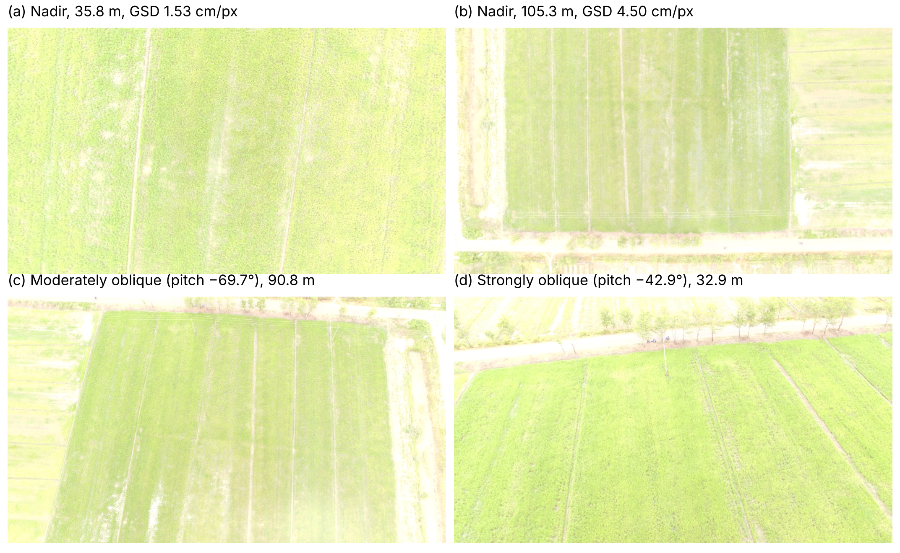

# Flight Altitude and Camera Angle Effects on Color-Space Features of Rice (UAV RGB)

Code and results for the article:

> Marsujitullah, H. D. Surjono, and H. Jati, "Effects of Flight Altitude and Camera Angle on Color-Space Features of Rice Canopies in Consumer-Grade UAV RGB Imagery," *Journal of Information Systems Engineering and Business Intelligence* (under review).

The study uses 242 original images from six flight sessions of a DJI Phantom 3 Standard (FC300C camera) over rice fields in Merauke Regency, South Papua, Indonesia. Within each session, altitude and gimbal pitch varied over the same fields, so the dataset is analysed as a natural experiment. Images are registered within each session (SIFT + RANSAC homography), 4 m × 4 m ground tiles are measured in every image, and HSV, CIELAB, and RGB-index features (ExG, VARI, GLI, NGRDI) are compared across acquisition settings.

## Repository contents

| Path | Content |
| --- | --- |
| `notebook/Paper3_Analisis_Colab.ipynb` | Complete analysis, ready to run in Google Colab |
| `src/pipeline.py` | Analysis functions (metadata, quality control, registration, tile features, simulation, statistics, figures) |
| `src/runner.py` | Script that runs all six analysis steps |
| `results/00_summary.json` | Counts of images, tiles, and observations, and the configuration used |
| `results/01_image_metadata_qc.csv` | Altitude, gimbal pitch, GSD, quality metrics, and exclusion reason for every image |
| `results/02_registration.csv` | Registration result (inliers, reference image) for every retained image |
| `results/03_tile_features_real.csv` | Color features of every tile in every real image |
| `results/04_tile_features_simulated.csv` | Color features of the same tiles after simulated resolution degradation |
| `results/05_real_vs_simulated.csv` | Agreement between real and simulated degradation |
| `results/06_hue_stability_index.csv` | Hue stability index of every tile |
| `results/07_sensitivity_ratio.csv` | Acquisition sensitivity ratio of every feature |
| `results/08_mixed_models.csv` | Fixed effects of GSD and camera angle from the linear mixed-effects models |
| `results/figures/` | Figures used in the article |

Feature names: `H_deg` hue (degrees), `H_veg_deg` hue of vegetation pixels, `S` saturation, `V` value, `L`, `a`, `b` CIELAB L*, a*, b*, `ExG`, `VARI`, `GLI`, `NGRDI` RGB indices. The suffix `_tm` denotes features computed from the tile-mean color.

## How to run

1. Open `notebook/Paper3_Analisis_Colab.ipynb` in Google Colab.
2. Set `IMAGE_ROOT` in cell 2 to the folder that holds the original `DJI_xxxx.JPG` images (subfolders are searched).
3. Select **Runtime → Run all**. Results are written to `OUT_DIR` (about 15–20 minutes for 242 images).

Requirements: Python 3, OpenCV, NumPy, pandas, Pillow, statsmodels, matplotlib.

## Data availability

The tile-level results in `results/` are openly available. The original images (about 1 GB) are available from the corresponding author on reasonable request.

## License

Code: MIT License (see `LICENSE`). Results and figures: Creative Commons Attribution 4.0 International (CC BY 4.0).

## Contact

Marsujitullah, Universitas Musamus / Universitas Negeri Yogyakarta, marsujitullah@unmus.ac.id (ORCID 0000-0002-8185-9073)
